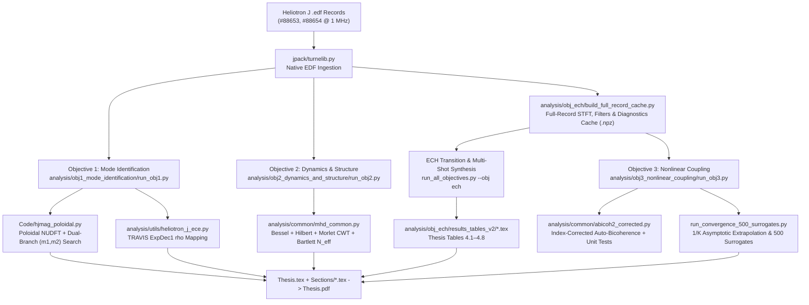

# Analysis of MHD Oscillations at Heliotron J with Python

This repository contains the complete Python analysis suite, LaTeX manuscript sources, compiled thesis PDF ([Thesis.pdf](Thesis.pdf)), generated figures, and structured JSON/CSV/LaTeX-table outputs accompanying the Bachelor's Thesis (*Trabajo Final de Graduación*, Instituto Tecnológico de Costa Rica — PlasmaTEC / Kyoto University Institute of Advanced Energy):

> **Analysis of MHD oscillations at Heliotron J with Python**  
> **Kevinrishor** — Supervised by Prof. Shigeru Inagaki (IAE, Kyoto University), Ph.D. Iván Vargas Blanco & M.Sc. Ricardo Solano Piedra (ITCR PlasmaTEC)

---

## Key Research Summary & Thesis Findings

Using multi-diagnostic experimental records from **Heliotron J** discharges **#88653** (primary study) and **#88654** (unpooled independent replicate), sampled at `fs = 1.0 MHz` across heating regimes (**ECH only**, **ECH+NBI**, and **NBI only**):

1. **Objective 1 — Mode Identification**:
   - Identifies a dominant energetic-particle/beta-induced Alfvén eigenmode (**BAE/EPM**) at **~89.4 kHz** in `#88653` during `ECH+NBI` (`259.1–291.3 ms`) and an auxiliary co-existing fluctuation in the **30–65 kHz** secondary band (**~38.9–40 kHz** centroid).
   - **Spatial Structure**: Single-mode poloidal non-uniform Discrete Fourier Transform (NUDFT) on `PMP1–PMP14` resolves **`m = +3`** (`r_circ = 0.84`) for the primary ~89 kHz mode, while toroidal array phase fitting (`MP1`, `MP3`, `MP4`; excluding off-plane `MP2`) yields **`n = -1` (aliased candidate `n = +3`)**. The secondary band requires an **820-pair dual-branch (`m1, m2` in `[-20, +20]`) decomposition** (`Code/hjmag_poloidal.py`), resolving **`m1 = +1, m2 = +12`** with **100% (`14/14` coils)** phase containment within `<= 45 deg`.
   - **Radial Localization & Edge Coupling**: Sixteen-channel ECE radiometry (`ECE1FAST`–`ECE16FAST`) mapped via the Heliotron J TRAVIS X2 ExpDec1 calibration (`analysis/utils/heliotron_j_ece.py`) and 18-coil cross-coherence isolate core-localized electron-temperature fluctuations peaking around `ECE12FAST` (`rho ~ 0.47`) and `ECE13FAST` (`rho ~ 0.29`), while `HAFAST7.5` (`gamma^2` coupling) links core MHD activity to edge `H_alpha` modulation.

2. **Objective 2 — Dynamics, Heating Response & Scaling Verification**:
   - Bessel bandpass + Hilbert envelope demodulation (`analysis/common/mhd_common.py`) reveals macroscopic locking between mode envelope/frequency and plasma current `Ip` and stored energy `Wp` (notably reversing sign across the **ECH-off transition at ~291.2–291.3 ms**).
   - Evaluates seven theoretical dispersion/scaling models (`1/sqrt(n_e)`, `sqrt(T_e)` BAE acoustic, `sqrt(v_A^2 + c_s^2)` coupled BAE, `Ip`, `Wp`, and combined terms) using Bartlett-corrected effective sample sizes `N_eff` and lagged cross-correlations, plus verification of low-pass filtered `ECE` temperature surrogates against global dynamics (`#88653` and `#88654`).

3. **Objective 3 — Nonlinear Wave-Wave Coupling & Asymptotic `1/K` Convergence**:
   - Corrects an index-convention bug in the legacy `LAS.abicoh2` estimator (`analysis/common/abicoh2_corrected.py`, verified by 5 analytical/synthetic unit tests in `analysis/common/test_abicoh2_corrected.py`).
   - Across short single windows (`7.936 ms`, `K = 30` sub-ensembles), control comparisons across pre-heating, ECH-only, ECH+NBI, NBI-only, and post-heating show finite-sample variance. Extending to the full steady **`32.1 ms` ECH+NBI window** (`259.1–291.2 ms`, `1/K <= 0.055`, `K in [18..38]` within-shot and `K <= 112` cross-shot) against **500 Fourier phase-randomized surrogates** demonstrates statistically significant, non-zero asymptotic bicoherence intercepts (`b^2(K) = b0 + C/K`):
     - **Primary harmonic steepening `(88, 88) -> 176 kHz`**: `b0 = +0.546` (`95% CI [+0.369, +0.728]`, `p_surr = 0.002` in `#88653`) and cross-shot `#88654` (`p_surr = 0.002`; difference form `(180 - 90) -> 90 kHz` with `b0 = +0.440`, `p_surr = 0.002`).
     - **Difference triad `(115 - 33) -> 82 kHz`**: `b0 = +0.146` (`95% CI [+0.059, +0.233]`, `p_surr = 0.014` in `#88653`).
     - **Cross-mode coupling `(47 + 80) -> 127 kHz`**: `b0 = +0.092` (`95% CI [+0.008, +0.179]`, `p_surr = 0.044` in `#88653`).
     - **Off-diagonal null controls**: `(33 + 80) -> 113 kHz` (`b0 = +0.017`, `p_surr = 0.315` in `#88653`) and `(72 + 76) -> 148 kHz` (`b0 = +0.005`, `p_surr = 0.365` in `#88654`) extrapolate to zero.

---

## Analysis Pipeline Architecture



---

## Thesis-to-Code Mapping (`Thesis.pdf`)

Every compiled figure, table, and code listing in [Thesis.pdf](Thesis.pdf) maps directly to tracked scripts and outputs in this repository:

| Thesis Reference | Description | Generating Script | Repository Asset Path |
| --- | --- | --- | --- |
| **Fig. 2.1** | Heliotron J coil/diagnostic geometry diagram | *(Static schematic)* | [Images/Locations.jpeg](Images/Locations.jpeg) |
| **Fig. 4.1** | `#88653` MP1 spectrogram with 3-sigma spectral dominance | `analysis/obj1_mode_identification/mhd_analysis_obj1.py` | [Images/obj1_mode_identification/panels/mhd_analysis_objective1_88653_panel1_mp1_spectrogram_with_3_sigma_dominance_r.png](Images/obj1_mode_identification/panels/mhd_analysis_objective1_88653_panel1_mp1_spectrogram_with_3_sigma_dominance_r.png) |
| **Fig. 4.2** | Primary mode poloidal decomposition (`PMP1–PMP14`, `m=+3`) | `analysis/obj2_dynamics_and_structure/mhd_analysis_obj2.py` | [Images/obj2_dynamics_and_structure/panels/mhd_analysis_objective2_structure_88653_80_120kHz_panel3_poloidal_mode_number_decomposition_pmp1.png](Images/obj2_dynamics_and_structure/panels/mhd_analysis_objective2_structure_88653_80_120kHz_panel3_poloidal_mode_number_decomposition_pmp1.png) |
| **Fig. 4.3** | Toroidal mode fit (`MP1, MP3, MP4`, `n=-1/+3`) | `analysis/obj1_mode_identification/mhd_primary_mode_id.py` | [Images/obj1_mode_identification/panels/mhd_primary_mode_toroidal_n_shot_88653_panel2_measured_phase_vs_theoretical_toroidal_p.png](Images/obj1_mode_identification/panels/mhd_primary_mode_toroidal_n_shot_88653_panel2_measured_phase_vs_theoretical_toroidal_p.png) |
| **Fig. 4.4** | Cross-coherence spectra by heating phase (`#88653` & `#88654`) | `analysis/obj_ech/plot_gap_figs_C.py` | [Images/obj1_mode_identification/fig_coherence_spectra_both_shots.png](Images/obj1_mode_identification/fig_coherence_spectra_both_shots.png) |
| **Fig. 4.5** | 16-ch ECE × 18-coil radial localization matrix (`#88653`) | `analysis/obj1_mode_identification/analyze_ece_all_probes_radial.py` | [Images/obj1_mode_identification/mhd_ece_all_probes_radial_localization_88653.png](Images/obj1_mode_identification/mhd_ece_all_probes_radial_localization_88653.png) |
| **Fig. 4.6** | 2D flux-surface / helical spatial mode reconstruction | `analysis/obj2_dynamics_and_structure/mhd_plot_2d_torus_maps.py` | [Images/obj2_dynamics_and_structure/mhd_mode_spatial_map_2d_88653.png](Images/obj2_dynamics_and_structure/mhd_mode_spatial_map_2d_88653.png) |
| **Fig. 4.7** | Whole-discharge heating, `Wp`, `n_e`, `Ip` timeline (`#88653`, `#88654`) | `analysis/obj_ech/plot_gap_figs_B.py` | [Images/obj2_dynamics_and_structure/panels/fig_heating_timeline_both_shots.png](Images/obj2_dynamics_and_structure/panels/fig_heating_timeline_both_shots.png) |
| **Fig. 4.8** | 1-ms block RMS vs. time across bands (`#88653`, `#88654`) | `analysis/obj_ech/plot_gap_figs_B.py` | [Images/obj2_dynamics_and_structure/panels/fig_rms_vs_time_both_shots.png](Images/obj2_dynamics_and_structure/panels/fig_rms_vs_time_both_shots.png) |
| **Fig. 4.9** | ECH-off `Wp` slope & amplitude transient (`#88653`, `#88654`) | `analysis/obj_ech/plot_ech_figures.py` | `Images/obj2_dynamics_and_structure/panels/fig_ech_wp_step_88653.png` & `fig_ech_wp_step_88654.png` |
| **Fig. 4.10** | ECH-off secondary-mode centroid frequency transition (`#88653`, `#88654`) | `analysis/obj_ech/plot_ech_figures.py` | `Images/obj2_dynamics_and_structure/panels/fig_ech_secondary_freq_88653.png` & `fig_ech_secondary_freq_88654.png` |
| **Figs. 4.11–4.13** | Macroscopic correlations (`Ip`, `Wp`, `n_e`) vs. primary mode envelope | `analysis/obj2_dynamics_and_structure/mhd_analysis_obj2.py` | `Images/obj2_dynamics_and_structure/panels/mhd_analysis_objective2_88653_80_120kHz_panel{1..3}_*.png` |
| **Fig. 4.14** | Low-pass filtered ECE temperature vs. stored energy verification | `analysis/obj2_dynamics_and_structure/plot_ece_lpf_te_single_figure.py` | [Images/obj2_dynamics_and_structure/mhd_ece_lpf_te_verification_88653.png](Images/obj2_dynamics_and_structure/mhd_ece_lpf_te_verification_88653.png) |
| **Figs. 4.15–4.16** | EP frequency scaling fit (Primary 80–120 kHz & Secondary 40–80 kHz) | `analysis/obj2_dynamics_and_structure/mhd_analysis_obj2.py` | `Images/obj2_dynamics_and_structure/panels/mhd_analysis_objective2_heating_88653_{80_120,40_80}kHz_panel4_*.png` |
| **Fig. 4.17** | Single-window bicoherence across 33 control windows (`#88653`, `#88654`) | `analysis/obj3_nonlinear_coupling/plot_control_windows.py` | [Images/obj3_nonlinear_coupling/fig_control_windows_v2.png](Images/obj3_nonlinear_coupling/fig_control_windows_v2.png) |
| **Fig. 4.18** | Index-corrected 2D auto-bicoherence maps (`#88653`, `#88654`) | `analysis/obj3_nonlinear_coupling/update_bicoherence_maps_converged.py` | [Images/obj3_nonlinear_coupling/fig_bicoherence_maps_both_shots.png](Images/obj3_nonlinear_coupling/fig_bicoherence_maps_both_shots.png) |
| **Fig. 4.19** | Asymptotic `1/K` extrapolation vs. 500 surrogates (`#88653`, `#88654`) | `analysis/obj3_nonlinear_coupling/generate_two_panel_convergence_fig.py` | [Images/obj3_nonlinear_coupling/fig_convergence_cumulative_v3_general.png](Images/obj3_nonlinear_coupling/fig_convergence_cumulative_v3_general.png) |
| **Tables 4.1–4.8** | Discharge phases, ECH switch-off, mode structure, Obj 2 & 3 stats, `1/K` convergence | `analysis/obj_ech/` & `analysis/obj3_nonlinear_coupling/` | [analysis/obj_ech/results_tables_v2/](analysis/obj_ech/results_tables_v2/) |
| **Listing B.1** | Dual-branch NUDFT poloidal mode search module | *(Source module)* | [Code/hjmag_poloidal.py](Code/hjmag_poloidal.py) |

---

## Repository Layout

```text
.
├── Thesis.pdf                              # Compiled thesis manuscript
├── Thesis.tex                              # Top-level LaTeX master document
├── ref.bib                                 # BibTeX references
├── Sections/                               # Canonical chapter .tex files included by Thesis.tex
├── Code/
│   └── hjmag_poloidal.py                   # Appendix B.1: Poloidal NUDFT + 820-pair search
├── analysis/
│   ├── common/
│   │   ├── abicoh2_corrected.py            # Index-corrected auto-bicoherence estimator
│   │   ├── test_abicoh2_corrected.py       # 5 analytical & synthetic unit tests (T1–T5)
│   │   └── mhd_common.py                   # Morlet CWT, Hilbert demodulation, anti-alias decimation
│   ├── utils/
│   │   └── heliotron_j_ece.py              # Heliotron J 16-ch ECE TRAVIS ExpDec1 rho calibration
│   ├── obj1_mode_identification/           # Objective 1 scripts + run_obj1.py
│   ├── obj2_dynamics_and_structure/        # Objective 2 scripts + run_obj2.py
│   ├── obj3_nonlinear_coupling/            # Objective 3 scripts + run_obj3.py
│   ├── obj_ech/                            # ECH-off synthesis, JSON results & Thesis LaTeX tables
│   └── heating_phase_comparison/           # Phase-split comparison scripts
├── jpack/                                  # Unmodified Kyoto Univ. turnelib EDF reader (Annex B)
├── Images/                                 # Generated thesis figures & individual panels
├── run_all_objectives.py                   # Unified CLI runner (--obj 1|2|3|ech or --all)
├── requirements.txt                        # Minimal Python dependencies
├── data/                                   # [Gitignored] Raw Heliotron J .edf files (Annex A)
└── cache/                                  # [Gitignored] Reconstructible .npz diagnostic caches
```

> **Note on Ignored Heavy Binary Directories (`data/`, `cache/`)**:
> Raw Heliotron J shot `.edf` files (`data/hj88653/`, `data/hj88654/`) and multi-megabyte cached `.npz` spectrograms (`cache/*.npz`) are intentionally gitignored. All lightweight derived JSON/CSV results, Thesis LaTeX tables, and publication figures are committed directly so readers can inspect outputs and regenerate JSON-backed figures immediately without requiring raw `.edf` access.

---

## Installation & Quick Start

### 1. Environment Setup
Python `>= 3.10` (developed on Python `3.12`) is required:

```bash
git clone https://github.com/Kevin-Rishor/Analysis-of-MHD-oscillations-at-Heliotron-J-with-Python-.git
cd Analysis-of-MHD-oscillations-at-Heliotron-J-with-Python-

python -m venv .venv
# Linux/macOS: source .venv/bin/activate
# Windows PowerShell: .venv\Scripts\Activate.ps1
pip install -r requirements.txt
```

Note that `jpack/turnelib.py` parses Heliotron J `.edf` records natively in pure Python and NumPy; `pyedflib` is not imported by the active pipeline and is commented out as optional in [requirements.txt](requirements.txt).

### 2. Reproducing Analyses Without Raw `.edf` Data
Even without raw `.edf` files, every unit test and all JSON-backed Thesis figures run cleanly out of the box:

```bash
# 1. Verify index-corrected auto-bicoherence estimator (5 unit tests)
python analysis/common/test_abicoh2_corrected.py

# 2. Verify Heliotron J 16-channel ECE rho mapping table
python analysis/utils/heliotron_j_ece.py

# 3. Run Objective 3 rectified pipeline (runs unit tests + Fig. 4.17 & Fig. 4.19 from committed JSONs;
#    also updates Fig. 4.18 bicoherence maps if cache/*.npz exists)
python analysis/obj3_nonlinear_coupling/run_obj3.py
```

### 3. Reproducing Full Workflows With Experimental `.edf` Files
1. Obtain Heliotron J `.edf` records for `#88653` and `#88654` via the official Kyoto University IAE data portal listed in **Annex A** (`https://heliotronj.iae.kyoto-u.ac.jp/expdata.html`) and place them under `data/hj88653/` and `data/hj88654/`.
2. Build the full-record STFT and diagnostic `.npz` caches:
   ```bash
   python analysis/obj_ech/build_full_record_cache.py
   ```
3. Run individual objectives or the complete pipeline:
   ```bash
   python run_all_objectives.py --obj 1
   python run_all_objectives.py --obj 2
   python run_all_objectives.py --obj 3
   python run_all_objectives.py --obj ech
   # Or run everything end-to-end:
   python run_all_objectives.py --all
   ```
4. Inspect poloidal `m` decomposition directly from CLI (`Listing B.1`):
   ```bash
   # Linux/macOS:
   PYTHONPATH=jpack python Code/hjmag_poloidal.py --shot 88653 --fmin 40000 --fmax 80000 --tstart 259.1 --tend 291.3
   # Windows PowerShell:
   $env:PYTHONPATH = "jpack"; python Code/hjmag_poloidal.py --shot 88653 --fmin 40000 --fmax 80000 --tstart 259.1 --tend 291.3
   ```

---

## Reusing Core Modules in Your Own Projects

The core signal-processing modules in `analysis/common/`, `analysis/utils/`, and `Code/` have minimal dependencies (`numpy`, `scipy`) and can be imported directly into external tokamak/stellarator or general time-series workflows:

### Index-Corrected Auto-Bicoherence (`analysis/common/abicoh2_corrected.py`)
Drops legacy asymmetric frequency-indexing bugs and fixes `detrend=False` + explicit `k1 + k2` sum indexing:

```python
import numpy as np
from analysis.common.abicoh2_corrected import abicoh2_corrected

# x: 1D uniformly sampled fluctuation trace at sampling rate fs (Hz)
freqs_hz, b2_matrix = abicoh2_corrected(
    x, fs=1.0e6, nfft=512, window="hann", noverlap=256, detrend=False
)
```

### Poloidal Mode-Number NUDFT & Dual-Branch Solver (`Code/hjmag_poloidal.py`)
Designed for **non-uniformly spaced magnetic probe arrays** where angular gaps create spatial aliasing. Combines single-mode circular correlation `r_circ` with exhaustive dual-branch `(m1, m2)` phase fitting:

```python
from Code.hjmag_poloidal import extract_nudft_and_phase, search_poloidal_modes

# Pass signals as a dict {channel: array_1d} with jpack/ on PYTHONPATH (sys.path.insert(0, "jpack"))
f_peak_khz, theta_rad, meas_phase = extract_nudft_and_phase(
    time_ms, fs, signals, fl_hz=40000.0, fu_hz=80000.0, t_start=259.1, t_end=291.3
)
single_best, dual_best = search_poloidal_modes(theta_rad, meas_phase, m_min=-20, m_max=20)
```

### Instantaneous Envelope, Frequency & Morlet CWT (`analysis/common/mhd_common.py`)
```python
from analysis.common.mhd_common import extract_instantaneous_frequency, morlet_cwt

env, inst_freq_hz, filtered_sig, analytic_sig = extract_instantaneous_frequency(
    sig, fs=1.0e6, fl_hz=80000.0, fu_hz=120000.0
)
wt_coeffs = morlet_cwt(sig, fs=1.0e6, freqs=freqs_grid)
wt_power = np.abs(wt_coeffs) ** 2
```

### Heliotron J ECE Radial Coordinate Mapping (`analysis/utils/heliotron_j_ece.py`)
```python
from analysis.utils.heliotron_j_ece import freq_to_rho, rho_to_freq, freq_to_r_cm

rho = freq_to_rho(66.5)   # Returns normalized minor radius r/a for 66.5 GHz
```

---

## Provenance, License & Citations

- **Thesis Manuscript**: [Thesis.pdf](Thesis.pdf) is licensed under **CC BY-NC-ND 4.0** (as declared on the title/license page of `Thesis.tex`).
- **Experimental Data**: Heliotron J discharge records (`#88653`, `#88654`) belong to the **Institute of Advanced Energy (IAE), Kyoto University** (`Annex A`: `https://heliotronj.iae.kyoto-u.ac.jp/expdata.html`).
- **Software Dependencies**: Includes `jpack` (2025 v1.0, `Annex B`) unmodified for Heliotron J `.edf` signal reading.

If you build upon this workflow or the corrected bispectral / dual-branch poloidal mode decomposition methods in academic work, please cite the accompanying thesis (`Thesis.pdf`).
